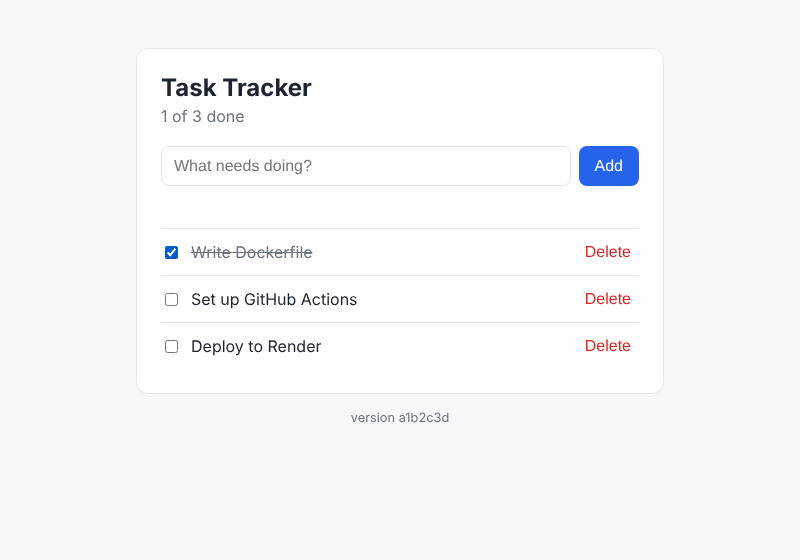

# ✅ Task Tracker: a complete CI/CD pipeline with GitHub Actions

[](https://github.com/Kaustubh3197/task-tracker-cicd/actions/workflows/ci-cd.yml)

**🌐 Live demo:** [task-tracker-kaustubh.onrender.com](https://task-tracker-kaustubh.onrender.com) _(free hosting: the first visit may take ~1 minute to wake up)_

A small Python web app (add, complete and delete tasks) used to show a **real-world CI/CD pipeline**.
Every change is automatically **linted, tested, packaged in Docker, published and deployed**,
and nothing reaches production unless every check passes.



**Tech:** Python · Flask · SQLite · pytest · Playwright · Ruff · Docker · GitHub Actions · GitHub Container Registry · Render · Dependabot

---

## 🤔 What is CI/CD?

| | Meaning | Question it answers |
|---|---|---|
| **CI**: Continuous Integration | Every code change is automatically checked and tested | *"Is this code good?"* |
| **CD**: Continuous Delivery / Deployment | Code that passes is automatically packaged and released | *"Can users get it now?"* |

Without CI/CD, a developer tests by hand, builds by hand and uploads to a server by hand, which is slow and error-prone.
With CI/CD, **`git push` is the only manual step.**

## 🔄 The pipeline

```
git push / pull request
        │
        ▼
┌──────────────────────── CI ─────────────────────────┐
│ 1. Lint & format      ruff: style, unused code       │
│ 2. Unit & API tests   pytest on Python 3.11–3.13,    │
│                       fails if coverage < 90%        │
│ 3. Browser tests      Playwright clicks through UI   │
│ 4. Docker image       build → start → /health →      │
│                       browser tests against it       │
└──────────────────────────────────────────────────────┘
        │  only on the main branch, only if all passed
        ▼
┌──────────────────────── CD ─────────────────────────┐
│ 5. Publish            push image to GitHub Packages  │
│ 6. Deploy             trigger Render, then wait until│
│                       the live site reports the new  │
│                       version                        │
└──────────────────────────────────────────────────────┘
```

On a **pull request**, steps 1–4 run and the result appears on the PR, so broken code can't be merged.
On a **push to `main`**, all 6 steps run and the new version goes live.

### Other automation in this repo
| File | What it does |
|---|---|
| `.github/workflows/release.yml` | Push a tag like `v1.0.0` → builds a versioned Docker image and creates a GitHub Release with auto-written notes |
| `.github/dependabot.yml` | Opens a PR every week when a library has an update. The pipeline tests it before you merge. |
| `.github/pull_request_template.md` | Checklist shown on every new pull request |

## 🧪 Tests (31 total)

| Type | Where | Count | What it checks |
|---|---|---|---|
| Unit | `tests/unit/test_services.py` | 12 | Title validation (including the 200-character limit) and counting logic |
| API | `tests/unit/test_api.py` | 10 | Every endpoint: success, bad input, 404s |
| Config | `tests/unit/test_version.py` | 3 | The version shown after a deploy |
| Browser (E2E) | `tests/e2e/test_ui.py` | 6 | A real browser adds, completes and deletes tasks |

The tests have caught real problems:
- **A UI bug:** typing a second task quickly wiped it out, because the input was cleared only *after* the first save finished. The browser tests caught it.
- **A gap in the tests themselves:** the title-limit tests read the limit from the app, so changing it from 200 to 100 went unnoticed. A new test now pins the **200-character requirement**, and CI blocked the change on its pull request.

## 📁 Project structure
```
├── app/
│   ├── __init__.py          # App factory
│   ├── routes.py            # Web page + JSON API
│   ├── services.py          # Business rules (validation, counts)
│   ├── db.py                # SQLite database
│   └── templates/index.html # The UI
├── tests/
│   ├── unit/                # Fast tests, no browser
│   └── e2e/                 # Playwright browser tests
├── .github/
│   ├── workflows/ci-cd.yml  # Main pipeline
│   ├── workflows/release.yml
│   └── dependabot.yml
├── Dockerfile
├── requirements.txt         # App dependencies
├── requirements-dev.txt     # + test/lint tools
└── pyproject.toml           # pytest, coverage & ruff settings
```

## 🌐 API

| Method | URL | Body | Result |
|---|---|---|---|
| GET | `/health` | | `{"status": "ok", "version": "abc1234"}` |
| GET | `/api/tasks` | | All tasks + summary counts |
| POST | `/api/tasks` | `{"title": "Buy milk"}` | Created task (201) or error (400) |
| PATCH | `/api/tasks/<id>` | `{"done": true}` | Updated task |
| DELETE | `/api/tasks/<id>` | | 204 No Content |

## ▶️ Run locally

```bash
python -m venv .venv
source .venv/bin/activate            # Windows (Git Bash): source .venv/Scripts/activate
pip install -r requirements-dev.txt
playwright install chromium

python wsgi.py                       # open http://localhost:5000

ruff check . && ruff format --check .
pytest tests/unit --cov              # unit + API tests with coverage
pytest tests/e2e --headed --slowmo 300   # watch the browser tests
```

With Docker:
```bash
docker build -t task-tracker .
docker run -p 8000:8000 task-tracker # open http://localhost:8000
```

## 🚀 Setup on GitHub

**Steps 1–5 work right away.** Push this repo to GitHub and open the **Actions** tab.
After the first push to `main`, the Docker image appears under **Packages** on your profile.

**Step 6 (live deployment) is optional and free on [Render](https://render.com):**
1. On Render: **New → Web Service** → connect this GitHub repo, giving Render access to **this repo only**. Render detects the `Dockerfile`. Choose the **Free** plan.
2. In the service settings, set **Auto-Deploy** to **Off** and **Pull Request Previews** to **Off**, so only the pipeline can deploy, and only after all tests pass.
3. Copy the service's **Deploy Hook** URL. Treat it like a password: never commit it or share it.
4. On GitHub: **Settings → Secrets and variables → Actions**
   - *Secrets* tab → `RENDER_DEPLOY_HOOK` = the hook URL (encrypted, and hidden as `***` in logs)
   - *Variables* tab → `APP_URL` = your site, e.g. `https://task-tracker-xxxx.onrender.com`
   - Safer alternative: add both under **Settings → Environments → `production`**, with deployment branches limited to `main`.
5. Push to `main` (or use **Actions → CI/CD → Run workflow**) and watch step 6 deploy and verify the live site.

> Free Render services sleep when idle (the first visit takes ~1 minute), and the SQLite data resets on each deploy. That's fine for a demo.

**Recommended security settings**
- **Two-factor authentication** on both GitHub and Render accounts.
- **Branch protection** (Settings → Branches → add rule for `main`): require the CI checks to pass before merging.
- **Secret scanning + push protection** (Settings → Code security): blocks pushes that accidentally contain secrets.
- **Manual approval before production** (optional; Settings → Environments → `production` → Required reviewers): the pipeline pauses at step 6 until you click *Approve*.

**Make a release**
```bash
git tag v1.0.0
git push origin v1.0.0
```

## 💡 Ideas to extend
- Add a **staging** environment that deploys first, then production after approval
- Replace SQLite with **PostgreSQL** (run it as a service container in the pipeline)
- Add **security scanning**: `pip-audit` for dependencies, Trivy for the Docker image
- Add **performance tests** with Locust
- Upload coverage to **Codecov** for a coverage badge